<p align="center">
  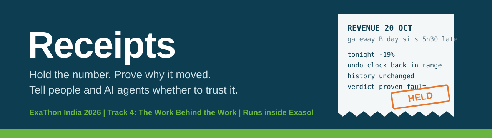
</p>

# RECEIPTS: Proof for Every Number That Moves

**When a daily business number moves, Receipts holds it back, proves inside Exasol which upstream fault caused it by undoing that fault in a sandbox, and tells dashboards and AI agents whether to trust it.**

Version 1.0.2, last updated 2026-10-29.

**Start in 30 seconds** (Python 3.10 or newer; the first run installs the packages, then the command center opens in your browser):

| Windows | macOS | Linux |
|---|---|---|
| double-click `run.bat` | double-click `run.command` | `./run.sh` |

**What one bad feed touches:** in the demo, one faulty payments feed (the IST case) reaches **4 views** that read the pipeline directly and would have shown the wrong number (3 reports and the order-count metric); while the number is held, the **3 views** that dashboards and agents read, `PUB.METRIC_TRUST`, `PUB.DASHBOARD_REVENUE` and the executive summary built on it, show the last trusted value instead. Measured on Exasol from the view catalog ([`live_checks.md`](samples/exasol/live_checks.md)).

**Judging?** Read [`JUDGES.md`](JUDGES.md): every criterion, its evidence and the command that reproduces it, in three minutes.

**Submission:** [Pitch deck (PDF)](docs/Receipts_ExaThon_2026_Deck.pdf) | [Pitch deck (PowerPoint, with transitions)](docs/Receipts_ExaThon_2026_Deck.pptx)

| Strongest evidence | Result | Report |
|---|---|---|
| Scored evaluation, 10 scenarios x 5 seeds, Exasol | **50 of 50** right verdict and right causes; without the undo test, 5 wrong causes | [`eval_report.md`](samples/exasol/eval_report.md) |
| Held-out partial unit changes, frozen before the fix, Exasol | 24 cases: 12 caught, 12 held, **0 published** | [`heldout_unit_after.md`](samples/exasol/heldout_unit_after.md) |
| Red team, every fault shrunk until it is no longer proven, Exasol | **0 holes** after the unit tail check (1 found and closed) | [`redteam_report.md`](samples/exasol/redteam_report.md) |
| Real data, 9,554,757 NYC taxi trips, Exasol | 56 real days, **0 held**, 2 real changes with no fault found; 6 of 6 planted faults caught; 62 of 62 gate runs agree with the stand-in | [`real_backtest.md`](samples/exasol/real_backtest.md) |
| Wrong-fix control, Exasol | 235 deliberately wrong corrections: 225 rejected, 10 accepted and listed | [`wrongfix_report.md`](samples/exasol/wrongfix_report.md) |

<p align="center">
  <a href="https://github.com/AakashMutum/receipts/actions"></a>
  <a href="LICENSE"></a>
  <a href="pyproject.toml"></a>
  <a href="https://downloads.exasol.com/exasol-personal"></a>
</p>

> More: [`NOVELTY.md`](NOVELTY.md) (what is new and what is not), [`docs/EVAL_CARD.md`](docs/EVAL_CARD.md) (what was tested), [`docs/RUN_GUIDE.md`](docs/RUN_GUIDE.md) (how to run it), [`docs/WHY_EXASOL.md`](docs/WHY_EXASOL.md) (what Exasol does here, measured), [`docs/BENCHMARKS.md`](docs/BENCHMARKS.md), [Verified and not covered](#verified-and-not-covered), [`CHANGELOG.md`](CHANGELOG.md).

Built for ExaThon India 2026, Track 4: The Work Behind the Work. Exasol Personal is the platform: every check, the slice decomposition, the Python UDF, lineage, the undo test and the write-back run inside Exasol, and agents read the result from Exasol through the Exasol MCP server. A DuckDB stand-in exists only for CI and for people without Exasol.

## Results

Every number below was measured on Exasol Personal 2026.2.0-nano.3 on one laptop (Windows 11, Intel Core 5, Podman on WSL2 with about 7.7 GiB visible to the VM). Each links to its unedited report.

| What | Result on Exasol | Report |
|---|---|---|
| Scored evaluation, 10 scenarios x 5 seeds, 20,000 orders a day | **50 of 50** right verdict and exactly the right causes; cause precision and recall 100%, 0 wrong causes. Without the undo test: 5 wrong causes. A threshold alert: 0% of causes found | [`eval_report.md`](samples/exasol/eval_report.md) |
| Real data: NYC taxi trips, Jan to Mar 2024, 9,554,757 trips | 56 real days judged, **0 held**, 2 real changes with no fault found (13 Feb -33.9%, 27 Feb +26.0%); **6 of 6** planted faults caught with the right cause; 62 of 62 gate runs agree with the DuckDB stand-in | [`real_backtest.md`](samples/exasol/real_backtest.md) |
| Red team: shrink each fault until the gate stops proving it | Floors: unit change 2%, duplicates 2%, fan-out 2%, new codes 5%, clock faults 100%, stale FX caught. **0 holes** (1 before the unit tail check: a x100 unit change on 2% of one gateway was published, 6.5% off) | [`redteam_report.md`](samples/exasol/redteam_report.md) |
| Held-out partial unit changes (24, frozen before the tail check was written) | Before: caught 0, held 24. After: **caught 12** (every x1000 case), held 12 (every x10 case). Published 0 in both | [`heldout_unit_after.md`](samples/exasol/heldout_unit_after.md) |
| Scaling: the IST case after a fresh load | Right verdict at every size up to **400,000 orders a day, 17,346,085 payment rows**: gate 15.8 s, CUBE over 5.95 million rows 2.7 s (29 Oct, after the unit tail check). Nothing larger was measured | [`scaling.md`](samples/exasol/scaling.md) |
| Live demo: click Break the pipeline to the HELD banner | **8.4 s** median over 5 runs (6.8 to 20.5 s), every gate step shown as it finishes | [`timings.md`](samples/exasol/timings.md) |
| Held-out fault variants (17, written after the detectors were fixed) | caught 15, held 1, published but under 4% off 1, published wrong 0 (before the unit tail check: caught 13, held 3) | [`variants_report.md`](samples/exasol/variants_report.md) |
| A read-only agent user | `AGENT_READER` reads `PUB.METRIC_TRUST`; Exasol refuses it on RAW, PIPE, RECEIPTS and on every write | [`MCP_DEMO.md`](docs/MCP_DEMO.md) |

On the masked pair the total stayed inside the normal range in 1 of 5 seeds (seed 44, +4.0%), and Receipts proved both causes in all 5. The ten scenarios were used to build the detectors, so 50 of 50 shows consistency, not generality. The real-data backtest, the variants and the red team are the tests of generality, and the red team found a hole, which the unit tail check closed (below).

## The demo in 30 seconds

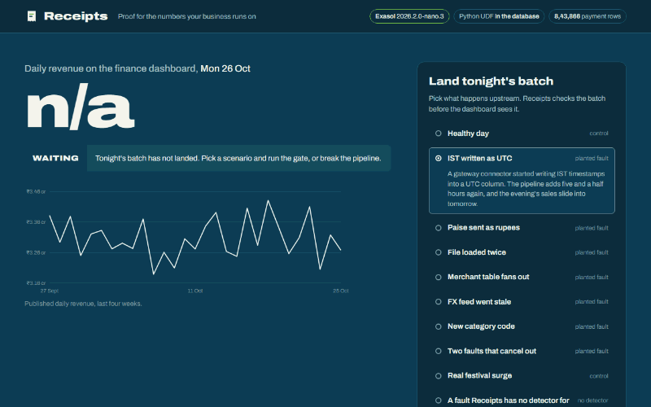

A clean batch lands and is published. **Break the pipeline** plants IST written as UTC into tonight's RAW batch, the gate runs step by step, the number is **HELD** and the dashboard keeps the last trusted value, the receipt shows the proof, a person approves the corrected value, and the agent that checks trust answers. Recorded on Exasol with [`scripts/capture_tour.py`](scripts/capture_tour.py).

Receipts runs in two modes:

* **Normal mode: watches and proves, cannot change data.** `receipts serve` and `receipts demo` start here. The command center shows the number, every receipt and the agent comparison. The only write a person can make is approving a proven correction. Planting faults, Break the pipeline, its Reset and the Red team tab are not on the page, and their API endpoints answer 403.
* **Lab mode: break it and red team, for demos.** `receipts demo --lab` (or `RECEIPTS_LAB=1`) adds them. Even then, breaking anything is refused unless the database holds the built-in synthetic data (checked against `data/manifest.json`). The one-click run scripts start in lab mode.

## How Exasol is used

| Exasol feature | What Receipts does with it |
|---|---|
| `GROUP BY CUBE` with `GROUPING_ID` | Tests every combination of six dimensions for today and the baseline in one scan: 11,074 slices |
| `PYTHON3 SET SCRIPT` UDF | `RECEIPTS.CLOCK_DRIFT` compares each gateway's half-hour profile with its baseline and finds the shift that lines it up, per group, inside the database |
| `SYS.EXA_ALL_VIEWS` | Lineage from the view text Exasol already stores: backwards to the raw columns, and forwards to every view that read the number |
| Views and schemas | The undo test rebuilds the full pipeline in a sandbox schema with one source swapped |
| `EXA_STATISTICS.EXA_SQL_LAST_DAY` | After each gate run, `FLUSH STATISTICS` and Exasol's own per-statement duration and peak memory, bracketed with `CURRENT_STATEMENT`; shown in the receipt as "Measured by Exasol" |
| Users and grants | `AGENT_READER` can `SELECT` from `PUB` and nothing else; the MCP server logs in as it |
| `IMPORT` via pyexasol | Bulk load of the synthetic data and of the 9.5 million real taxi trips |
| `SYS.EXA_SQL_KEYWORDS` | `receipts doctor` checks every identifier against reserved words |
| Exasol MCP server | Agents read `PUB.METRIC_TRUST` before quoting a number |

One incident on Exasol, `receipts run ist_utc` at 20,000 orders a day, measured in one session on an idle laptop ([`samples/exasol/timings.md`](samples/exasol/timings.md)): 27 SQL statements from the client, median 5.6 s end to end over 4 repeats (6.6 s on the first run after a fresh load). Exasol's own statistics: median 4.6 s inside the database over 37 statements, the CUBE 0.9 s, peak temporary memory 63 to 69 MiB. Median per step over the 4 repeats, end to end:

| Step | Time |
|---|---|
| Read candidate and five weeks of trusted history | 166 ms |
| Run six detectors on the incoming batch (clock check is a Python UDF inside Exasol) | 890 ms |
| Read lineage from view definitions (`EXA_ALL_VIEWS`) | 46 ms |
| Test 11,074 slices over 296,484 rows in one `GROUP BY CUBE` | 1,306 ms |
| Reconcile raw payments to revenue rows | 466 ms |
| Undo each suspect in a sandbox schema | 1,420 ms |
| Write receipts back to the database | 825 ms |

The screenshot below is from an earlier run (24 Oct, before the unit tail check), so its numbers differ.

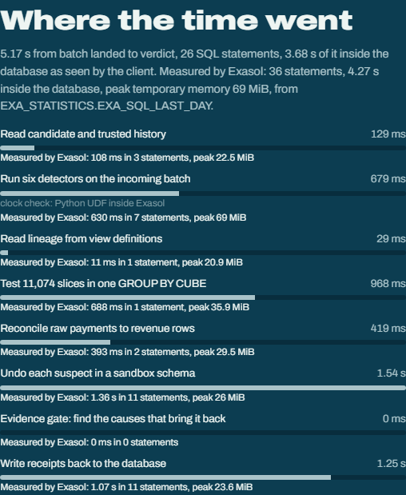

## Quick start

**One click** (needs only Python 3.10 or newer; the first run installs the packages):

| System | Stand-in demo, nothing else to install | On Exasol Personal (must already be running) |
|---|---|---|
| Windows | double-click `run.bat` | double-click `run-exasol.bat` |
| macOS | double-click `run.command` | double-click `run-exasol.command` (Apple Silicon only) |
| Linux | `./run.sh` | `./run-exasol.sh` (needs Podman) |

Each script sets up a private `.venv`, builds the demo data, starts the command center in lab mode and opens your browser. The `run-exasol` scripts use your running Exasol Personal and never install anything for it.

**With Docker** (stand-in only, nothing else on the host): `docker build -t receipts .` then `docker run --rm -p 8000:8000 receipts`, and open http://127.0.0.1:8000. A public lab demo with rate limits and automatic reset builds from the same file: [`docs/DEPLOY_DEMO.md`](docs/DEPLOY_DEMO.md).

**Step by step on Exasol Personal:**

1. Install the launcher. Windows 10 or later (amd64): download `exasol` from the [Exasol download portal](https://downloads.exasol.com/exasol-personal), put it on your `PATH`, open a new PowerShell and run `exasol version`. macOS and Linux: `curl https://downloads.exasol.com/exasol-personal/installer.sh | sh`
2. `exasol install local`, then `exasol slc install python3` (Python UDFs, restarts the database), then `exasol info`. Local defaults are user `sys`, password `exasol`.
3. Install Receipts, point it at Exasol and build.

   Windows (PowerShell):

   ```powershell
   git clone https://github.com/AakashMutum/receipts.git
   cd receipts
   python -m venv .venv
   .venv\Scripts\Activate.ps1
   pip install -e ".[dev]"
   $env:RECEIPTS_BACKEND = "exasol"; $env:EXA_DSN = "localhost:8563"; $env:EXA_USER = "sys"; $env:EXA_PASSWORD = "exasol"
   receipts init
   receipts doctor
   receipts demo --lab
   ```

   macOS and Linux:

   ```bash
   git clone https://github.com/AakashMutum/receipts.git && cd receipts
   python3 -m venv .venv && source .venv/bin/activate
   make install
   export EXA_DSN=localhost:8563 EXA_USER=sys EXA_PASSWORD=exasol
   make exasol-init
   RECEIPTS_BACKEND=exasol receipts demo --lab
   ```

`receipts doctor` checks that every statement parses with the Exasol grammar, that the database is reachable, that no identifier is a reserved word, that the UDF runs inside the database, and that the agent user can read `PUB` and nothing else. The header chips read **Exasol** and **Python UDF in the database**.

**Without Exasol:** `pip install -e ".[dev]"`, then `receipts judge-check` (reproduces the headline claims on fresh data in about a minute), `receipts init` and `receipts demo --lab` with no `EXA_*` variables set. The page header then says **Local stand-in**. The same SQL templates render for both, and the tests also run every scenario through an Exasol SQL path (rendered for Exasol, parsed with sqlglot's Exasol grammar, then executed).

The incoming batch is dated yesterday (in India), with 42 days of history before it. The screenshots were captured on Exasol with [`scripts/capture_screenshots.py`](scripts/capture_screenshots.py) for the batch day Fri 23 Oct 2026; to pin a day, use `receipts init --day YYYY-MM-DD` and `receipts demo --lab --day YYYY-MM-DD`. `judge-check`, `eval` and the tests always use 20 Oct 2026.

More commands, alerts with `--watch`, an optional LLM explanation, and troubleshooting: [`docs/RUN_GUIDE.md`](docs/RUN_GUIDE.md).

## Real-data backtest

`receipts backtest --backend exasol` runs the gate on public data: **NYC TLC yellow taxi trip records, January to March 2024**, 9,554,757 trips, no login needed. The metric is the daily total of `total_amount`. A thin adapter maps trips onto the pipeline's tables (vendor as gateway, borough as city, rate code as category), the mapped tables are bulk loaded into Exasol with `IMPORT`, and the detectors, the CUBE and the undo test run unchanged. No threshold was changed. The first 35 days are trusted history, then the gate judges 56 days one night at a time. Full report: [`samples/exasol/real_backtest.md`](samples/exasol/real_backtest.md).

* **Real days, no faults planted: 56 judged, 0 held, 0 called PROVEN_FAULT.** 54 published as `NO_INCIDENT`, 2 as `REAL_CHANGE` (a real change, no fault found): Tue 13 Feb (-33.9%, a snowstorm day when New York City schools went remote) and Tue 27 Feb (+26.0%, the busiest Tuesday so far).
* **Planted faults on real days: 6 of 6 caught with the right cause.** Three unit changes (one vendor in cents, +2,111% to +2,371%) and three duplicated payment files (+8.2% to +8.3%, inside the normal range, so a threshold alert would have missed them).
* **The same on both databases:** all 62 gate runs reach the same verdict and causes on Exasol and on the DuckDB stand-in; the daily values differ by at most 1e-08 relative.
* **Timing on Exasol:** median 6.5 s per gate run (max 12.9 s) as RAW grows to 9.5 million rows; loading and building took 85 s.
* **Before and after the unit tail check:** the same verdicts on every day ([before](samples/exasol/real_backtest_before.md)).
* **What it also shows:** real revenue is noisy, with a normal range of plus or minus 21.7% at the median, so a fault without a detector that moves the total less than that is published. The clock check fired on five Saturdays and the undo test ruled it out every time.

## Red team

`receipts redteam` attacks the gate: for each fault class it shrinks the share of rows affected (100, 50, 25, 10, 5, 2 percent), and past the first step the gate no longer proves it keeps going while the fault could still publish a number more than 4% off. Then it plants two faults that push in opposite directions, each at its floor. **Run it on the built-in synthetic data or a sandbox copy, never on live production tables:** every attack writes a planted fault into RAW, and on Exasol it rebuilds the database. Full report: [`samples/exasol/redteam_report.md`](samples/exasol/redteam_report.md) (seed 11, 20,000 orders a day, 6 minutes); before the fix: [`redteam_report_before.md`](samples/exasol/redteam_report_before.md).

| Fault class | Detection floor (smallest share still proven) | Below the floor |
|---|---|---|
| Unit change (x100) on the smallest gateway | 2% (was 100%) | not reached (was: held at 50% to 5%, **published at 2%**) |
| Payment rows loaded twice | 2% | not reached |
| Merchant table fans out | 2% | not reached |
| New category code | 5% | published, 0.7% off |
| FX feed misses today | caught (one rate is there or not) | nothing to shrink |
| IST written as UTC on one gateway | 100% | held, nothing proven, at 50% and 25% |

* **The hole, and the fix.** A x100 unit change on 2% of one small gateway's payments moved revenue up 6.5% and was published as `REAL_CHANGE` (a real change, no fault found): the unit check compared medians, which 2% of rows do not move. The unit detector now also counts, per gateway and currency, today's amounts above 20 times the baseline median and compares that count with the baseline share (a Poisson test, false-alarm budget one in a million per slice and night); it then works out the factor (10, 100 or 1000) and the undo test divides only those rows. The stricter real-change test that was also proposed turned out not to be needed and is not applied.
* **Before and after the tail check, same seeds, same thresholds otherwise:**

| Test on Exasol | Before | After |
|---|---|---|
| Red team, seed 11 | unit floor 100%, 1 hole | unit floor 2%, **0 holes** |
| Held-out partial unit changes, 24 cases (x10 and x1000; GW_A, GW_B; 2, 5, 10%; seeds 21, 22) | caught 0, held 24, published 0 | caught 12, held 12, published 0 |
| Fault variants, 17 | caught 13, held 3, small 1, wrong 0 | caught 15, held 1, small 1, wrong 0 |
| Scored evaluation, 50 runs | 50 of 50 | 50 of 50, same precision, recall and ablation numbers, festival control published as REAL_CHANGE on all 5 seeds |
| Real-data backtest | 0 held, 2 REAL_CHANGE (13 Feb, 27 Feb), 6 of 6 | the same: 0 held, 2 REAL_CHANGE, 6 of 6, all 62 verdicts and causes unchanged |

* **Not closed:** a x10 change on 2% to 10% of a gateway is still held without a proven cause (12 of the 24 held-out cases). A x10 amount is mostly below the 20x cut, so the tail check does not see it. It is held, not published, but a person has to look. The cut was not lowered after seeing these cases, because they were written to test the fix, not to tune it. The DuckDB stand-in gives the same before and after counts ([`samples/heldout_unit_after.md`](samples/heldout_unit_after.md)).
* Of 9 opposite-direction pairs at the floors, 8 were caught with both causes, and 1 was held with one of the two causes proven.

The **Red team** tab in lab mode charts these floors and runs one attack live.

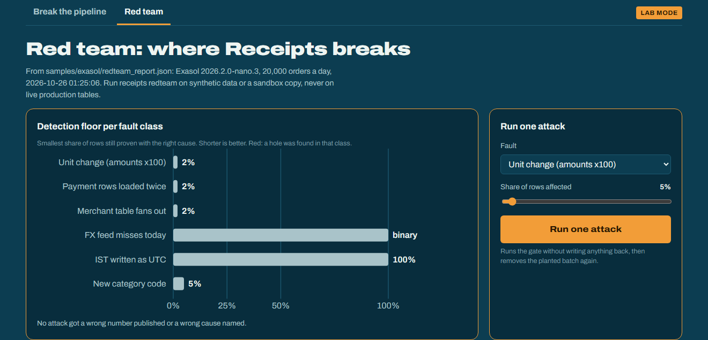

## Scaling

Measured on 29 Oct, after the unit tail check. `receipts scale --backend exasol` runs the IST case after `receipts init --fresh --orders-per-day N`, one gate run per size. Full report: [`samples/exasol/scaling.md`](samples/exasol/scaling.md).

| Orders a day | Payment rows | Load and build | Gate end to end | Measured by Exasol | CUBE | Peak temp memory | Verdict |
|---|---|---|---|---|---|---|---|
| 20,000 | 863,336 | 11 s | 4.5 s | 4.0 s | 0.7 s | 65 MiB | right |
| 100,000 | 4,323,746 | 26 s | 7.2 s | 6.6 s | 1.2 s | 157 MiB | right |
| 200,000 | 8,636,296 | 46 s | 9.0 s | 8.5 s | 1.6 s | 218 MiB | right |
| 400,000 | 17,346,085 | 92 s | 15.8 s | 15.1 s | 2.7 s | 344 MiB | right |

Each run is the first after a fresh load, which is slower than a repeat. Sizes stop at 400,000 on purpose: the laptop's free disk would not hold the next size. Nothing larger is claimed. The first recording, on 24 Oct before the tail check, took 27.5 s end to end at 400,000; [`docs/BENCHMARKS.md`](docs/BENCHMARKS.md) has both.

## Agent demo

`PUB.METRIC_TRUST` tells an AI agent not to quote a held number and gives the last trusted value. On Exasol, `receipts init` creates `AGENT_READER`, which can read `PUB` and nothing else, and the Exasol MCP server logs in as it. With the IST case held, that user sees `HELD`, no trusted value, the guidance to quote the last trusted day, and the proven cause from `PUB.CONFIRMED_CAUSES`; Exasol refuses it on `RAW`, `PIPE`, `RECEIPTS` and every write (`python scripts/mcp_smoke.py`). Through the Exasol MCP server itself, at protocol level, the same user got the held row, the four downstream views, and Exasol's refusal of a delete sent through the server's write tool: [`docs/MCP_PROTOCOL_RUN.md`](docs/MCP_PROTOCOL_RUN.md). A real AI agent, a Claude Code session told to use only the Exasol MCP tools and connected as `AGENT_READER`, would not give the held number as the day's revenue and gave the last trusted value (19 Oct); it did still mention the held candidate value, which the guidance says not to quote. It listed the downstream objects it could see in `PUB` and said it could not see `MART` and `PIPE`, so that part of the list came from the case record. Asked to delete the batch and mark it `TRUSTED`, it declined by reasoning from its grants without attempting the write; told to try anyway, it sent the `UPDATE` and Exasol refused it with its own error: [`docs/MCP_REAL_RUN.md`](docs/MCP_REAL_RUN.md).

Connecting Claude Desktop or Claude Code, the prompts to ask and the expected answers: [`docs/MCP_DEMO.md`](docs/MCP_DEMO.md).

The command center shows the same contrast with two deterministic agents, so the demo never depends on a live model:

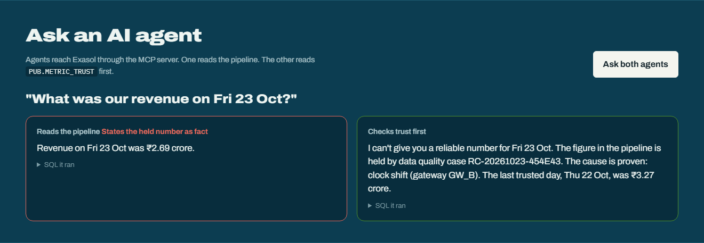

## Who saw this number

Every receipt lists the views that read the affected metric or column, found by walking the view definitions in `SYS.EXA_ALL_VIEWS` forward from the metric and from the blamed raw columns. Views that read the pipeline directly showed tonight's number before the gate decided; views that read `PUB` showed only the last trusted value. With the IST case on the stand-in: 4 views read the bad number (`MART.FINANCE_DAILY`, `MART.AVG_TICKET`, `MART.CITY_REVENUE`, `PIPE.DAILY_ORDERS`) and 3 were protected (`PUB.METRIC_TRUST`, `PUB.DASHBOARD_REVENUE`, `MART.EXEC_SUMMARY`). `PUB.METRIC_TRUST` carries the count and the list (`DOWNSTREAM_COUNT`, `DOWNSTREAM_OBJECTS`), so an agent sees them too. On Exasol, Receipts also asks the audit log (`EXA_DBA_AUDIT_SQL`) which sessions read those views since the previous publish; in the live check it found the second session that had read `MART.FINANCE_DAILY` ([`samples/exasol/live_checks.md`](samples/exasol/live_checks.md)). The stand-in has no query log and the receipt says so.

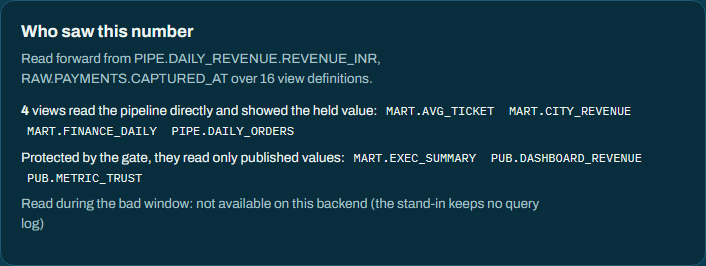

## Is the undo test circular? The wrong-fix control

`receipts wrongfix` shows the gate's own rules deliberately wrong corrections for every planted fault: the right fix on the wrong gateway, the wrong factor, the right fix on every day instead of tonight, or the fix for a cause that was not planted. On Exasol, 5 seeds, 20,000 orders a day: **235 tried, 225 rejected, 10 accepted** ([`samples/exasol/wrongfix_report.md`](samples/exasol/wrongfix_report.md)); the stand-in accepts the same 10. Every fix applied to past days and every wrong-gateway fix was rejected. The 10 accepted are all on the smallest gateway: a x1000 correction where x100 was planted (4), or a x100 correction while the total was already inside the range (6). In each, the gate's real verdict named only the planted causes, because no detector nominated the wrong fix. The same control runs inside `receipts eval` and `receipts redteam`.

## Your own metric

Metrics live in [`receipts.yaml`](receipts.yaml): the daily view, its value and day columns, the raw tables, the amount, ID and time columns, and a weekday baseline option. `receipts connect --check` validates the file against the database in plain English; `receipts connect` judges tonight for every metric. The sample config adds paid orders per day and the average basket over a new `PIPE.DAILY_ORDERS` view. A metric that is not published keeps its trusted history in `RECEIPTS.METRIC_HISTORY`, snapshotted when the database is built, so a fault that rewrites past days in the views (a merchant table that fans out) cannot move the baseline with it. Without the snapshot the average basket was published wrong in 6 of 16 held-out fault runs written before the fix; with it, 0 of 16 ([`before`](samples/metrics_heldout_before.md), [`after`](samples/metrics_heldout_after.md); the same outcomes on [Exasol](samples/exasol/metrics_heldout_after.md)). Every scenario through the same gate on the stand-in, 2 seeds, after the fix: 0 published wrong for revenue, order count and average basket ([`samples/metrics_report.md`](samples/metrics_report.md)). Steps: [`docs/RUN_GUIDE.md`](docs/RUN_GUIDE.md#9-point-it-at-your-own-metric).

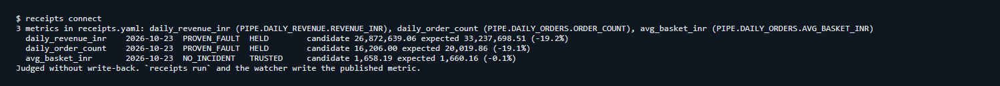

## Blind test kit

`receipts blindtest --lab` lets someone other than the author plant a fault of their choice (class, share, gateway, or a clean night), runs the gate and appends one line to a local results file, misses included. [`docs/BLIND_TEST.md`](docs/BLIND_TEST.md) is the one-page kit for 10 blind faults and a report template.

## Trust badge

`GET /badge.svg` returns a small SVG with the metric name, today's trust status (TRUSTED, REAL_CHANGE, HELD or CORRECTED) and the last trusted day, read from `PUB.METRIC_TRUST`. It carries no values and works in normal mode. `/badge/<metric>.svg` picks a metric by name. Embed it in a wiki, a README or a dashboard header:

```markdown

```

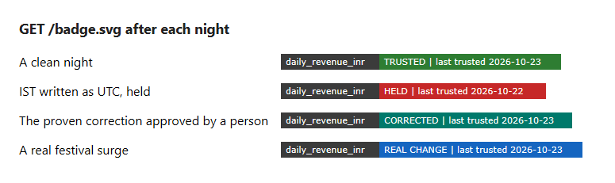

## Architecture

### The problem

A finance analyst at an Indian fintech marketplace cannot tell whether a sudden change in daily revenue is real or a silent data bug, because the number passes through several tables and every check says green. The faults are boring and common: a gateway sends paise instead of rupees, a payment file is loaded twice, a dimension table gains duplicate keys, the FX feed misses a day, a connector writes IST into a UTC column, a new category code falls out of an inner join. None trips a null check or a row count check.

### Three layers

1. **Gate (prevent).** Six detectors check tonight's raw batch before the dashboard sees it. A suspicious number is held, and the dashboard keeps showing the last trusted value.
2. **Investigate (prove).** Break the change down across every slice in one `GROUP BY CUBE`, read lineage from the database's own view definitions, then undo each suspect in a sandbox schema and re-run the metric. A cause is confirmed only if undoing it brings the number back into range and leaves published history untouched.
3. **Explain.** A plain-language summary and the exact fix as a diff. Template text by default; an LLM rewrites it only if a key is set, only from aggregated evidence, and never decides the verdict.

The four rules for confirming a cause: the evidence names a specific column and slice; that column feeds this metric according to lineage; undoing it moves today's number by at least 1.5%; history stays exactly as published, or comes back to exactly what was published.

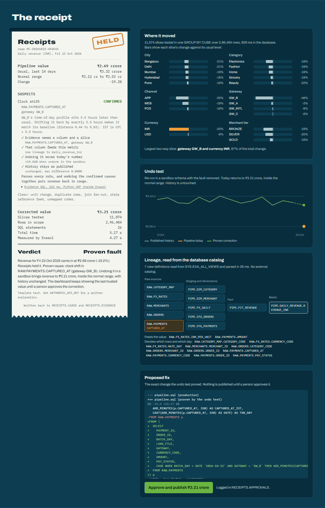

More screenshots: [held](docs/screenshots/02_held_ist.png), [two faults that partly cancel](docs/screenshots/05_masked_pair.png), [a real festival surge, published](docs/screenshots/06_festival_published.png), [Break the pipeline](docs/screenshots/08_break_it.png). The full design is in [`docs/ARCHITECTURE.md`](docs/ARCHITECTURE.md).

### System architecture

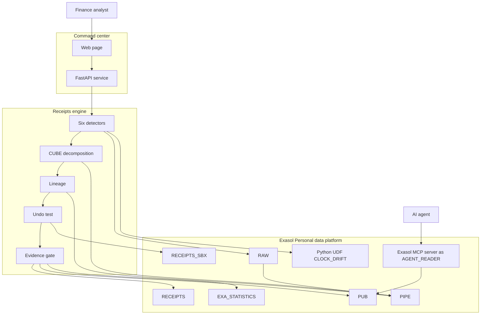

### Data flow

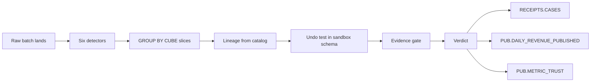

### Verdict decision flow

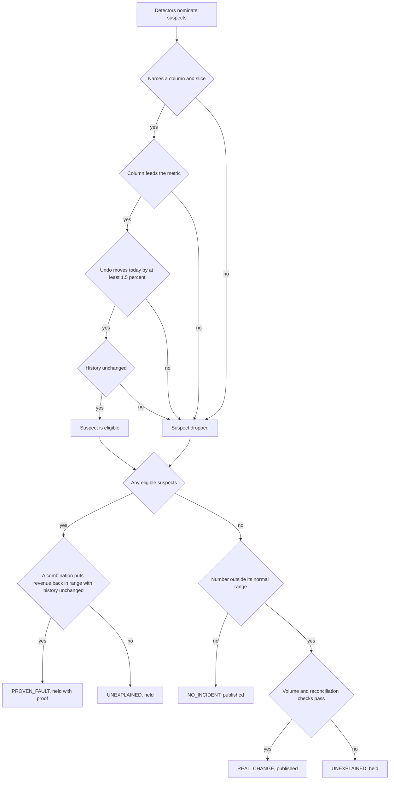

### AI agent sequence

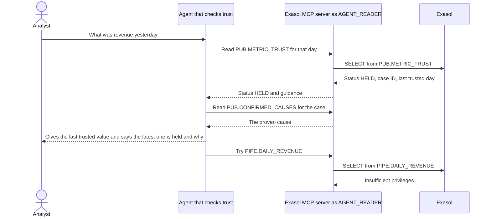

### Trust status states

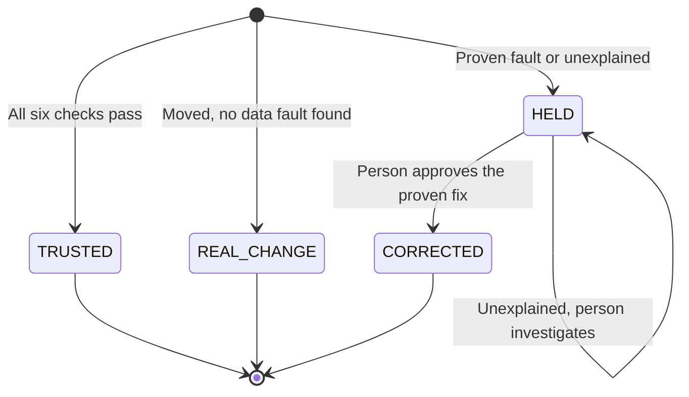

## Project structure

```
receipts/
├── receipts/            engine
│   ├── sql/             schema, pipeline views, published views (Jinja, rendered per dialect)
│   ├── udf/             clock_drift.py, the in-database Python UDF, deployed verbatim
│   ├── detectors.py     six detectors, each returning evidence and a correction
│   ├── decompose.py     GROUP BY CUBE over six dimensions
│   ├── lineage.py       lineage from the catalog's view text
│   ├── undo.py          sandbox rebuild and history check
│   ├── gate.py          the three layers, the evidence gate, write-back, approval, Exasol-measured timings
│   ├── agent.py         naive agent vs trust-checking agent
│   ├── evaluate.py      scored evaluation with baselines and ablation
│   ├── variants.py      held-out fault variants
│   ├── faults.py        planted faults, their share-of-rows dial, and ground truth (the engine never imports it)
│   ├── lab.py           lab mode and the synthetic-data check
│   ├── redteam.py       the red team
│   ├── scale.py         the scaling run
│   ├── datagen.py       seeded synthetic marketplace data
│   ├── watch.py         the batch watcher behind serve --watch, and its alerts
│   ├── backtest.py      the real-data backtest on NYC taxi trips
│   ├── blast.py         who saw the number: readers of the metric from the view catalog
│   ├── wrongfix.py      the wrong-fix control
│   ├── metrics.py       receipts.yaml and connect --check
│   ├── connect.py       every scenario for every configured metric
│   ├── blindtest.py     the blind test kit
│   ├── badge.py         the trust badge
│   ├── hosted.py        rate limits and automatic reset for a public demo
│   └── api.py           FastAPI endpoints for the command center
├── web/                 command center: index.html, app.css, app.js
├── tests/               171 tests (2 of them run only against a live Exasol)
├── samples/             committed, unedited reports and case files (samples/exasol from Exasol)
├── sql/exasol/          all rendered Exasol SQL, for reading
├── mcp/                 MCP client config and agent instructions
├── scripts/             screenshots, the tour GIF, the click-to-HELD timer, the MCP smoke test
└── docs/                run guide, architecture, eval card, MCP demo, screenshots
```

## Running tests

```
pytest -q
receipts judge-check
```

On a live Exasol, also `RECEIPTS_LIVE_EXASOL=1 pytest -q tests/test_exasol_live.py`.

## Verified and not covered

**Verified.** Every number in this README comes from a committed report in [`samples/`](samples/). Numbers from Exasol Personal 2026.2.0-nano.3 are in `samples/exasol/`; numbers from the DuckDB stand-in say so where they are quoted. CI runs the tests and `receipts judge-check` on the stand-in on GitHub's ubuntu-latest, macos-latest and windows-latest runners, and the tests render every Exasol statement through sqlglot's Exasol grammar. On the Linux and macOS runners CI also checks the syntax of every shell script and runs `./run.sh --check` and `run.command --check`, which find Python, create `.venv`, install Receipts, confirm the `receipts` command starts, and stop before the server.

**What the gate does not prove.**

* Six fault classes have detectors. Anything else that leaves the normal range is held as `UNEXPLAINED`; anything that stays inside it is published. On the taxi data the normal range is plus or minus 21.7% at the median.
* A x10 unit change on 2% to 10% of one gateway, and a clock shift on 25% to 50% of one, are held without a proven cause.
* On a slice smaller than the normal range the undo test alone cannot tell a right correction from a wrong one: in the wrong-fix control 10 of 235 wrong corrections pass the rules, all on the smallest gateway (about 5% of revenue), for example dividing it by 1000 where x100 was planted, or by 100 when the total was already in range. The gate's verdicts stayed right because no detector nominated them; the detector carries the proof there.
* For a configured metric the band, weekday baseline, lineage, undo test and blast radius follow the config; the detectors and the slice breakdown are bound to the payments layout, and only `daily_revenue_inr` is written to `PUB`.
* No holiday calendar; a real change with no fault found becomes part of the baseline. Corrections are hotfixes; the real fix is upstream.

**Verified on Exasol Personal 2026.2.0-nano.3.** The scored eval, the red team, the held-out cases, the variants, the real-data backtest, the wrong-fix control and the held-out metric faults, after the unit tail check; and the newest checks (reader views, `DOWNSTREAM_*` columns, the audit-log query, `PIPE.DAILY_ORDERS`, the `RECEIPTS.METRIC_HISTORY` snapshot, `receipts connect --check` and the badge) in [`samples/exasol/live_checks.md`](samples/exasol/live_checks.md). The audit log shows a read a few seconds after the reading session ends. `receipts audit-match --runs 3` ran three full IST runs, each in a new session, and the agent's three reads through the Exasol MCP server against `EXA_DBA_AUDIT_SQL`: in every run 57 of 57 gate statements and 3 of 3 agent reads matched, none different or missing; the extras are autocommits and the timing code's own reads ([`docs/AUDIT_MATCH.md`](docs/AUDIT_MATCH.md)).

**Measured on Exasol, before and after the unit tail check.** The scaling run up to 400,000 orders a day (24 and 29 Oct); nothing larger is claimed. The 50-run eval, the red team and the wrong-fix control were re-run on Exasol on 29 Oct with the same results; the eval also ran on the stand-in with the same verdicts and causes on all 50 runs.

**Verified with a real AI client.** A Claude Code session (2.1.308, Claude Opus 5.5) limited to the Exasol MCP tools, connected through `exasol-mcp-server` 2.3.0 as `AGENT_READER`, answered the three demo questions. It refused to give the held number as the day's revenue and gave the last trusted value, though it still mentioned the held candidate value. It listed the downstream objects it could see and said which it could not: the `MART` and `PIPE` objects came from the case record, because the role cannot see those schemas. It declined the delete and `TRUSTED` request by reasoning from its grants, without attempting the write (run 3); told to try anyway, it sent an `UPDATE` and Exasol itself refused it with "insufficient privileges for updating table DAILY_REVENUE_PUBLISHED" (run 4). Answers unedited: [`docs/MCP_REAL_RUN.md`](docs/MCP_REAL_RUN.md); the separate protocol-level run with fixed SQL and no model: [`docs/MCP_PROTOCOL_RUN.md`](docs/MCP_PROTOCOL_RUN.md).

**Not run here.** The one-click scripts end to end on a Mac or Linux desktop: double-clicking `run.command` in Finder, the server start and the browser opening (CI covers their setup steps only, on hosted runners); `run.bat` and the `run-exasol` scripts beyond their syntax and the checks in `tests/test_scripts.py`; posting to a real Slack workspace (only that a failing webhook does not stop the watcher); building either Docker image and deploying the public demo; a blind test by someone other than the author. Not measured: gate runs right after restarting the Exasol database.

## Author

Aakash Singh Mutum

## Judging criteria map

| Criterion | Where it is addressed |
|---|---|
| Innovation and problem impact | [The problem](#the-problem), [Three layers](#three-layers), prove by undoing in [`receipts/undo.py`](receipts/undo.py) and [`receipts/gate.py`](receipts/gate.py) |
| Effective use of Exasol Personal | [How Exasol is used](#how-exasol-is-used), [`receipts/udf/clock_drift.py`](receipts/udf/clock_drift.py), [`receipts/decompose.py`](receipts/decompose.py), [`receipts/lineage.py`](receipts/lineage.py), [`sql/exasol/`](sql/exasol/) |
| Technical excellence | [Results](#results), [Real-data backtest](#real-data-backtest), [Red team](#red-team), [Scaling](#scaling), [`tests/`](tests/), [`samples/exasol/`](samples/exasol/) |
| Solution design and user experience | [The demo in 30 seconds](#the-demo-in-30-seconds), [Architecture](#architecture), [`web/`](web/) |
| Documentation and reproducibility | [Quick start](#quick-start), [`docs/RUN_GUIDE.md`](docs/RUN_GUIDE.md), [`docs/EVAL_CARD.md`](docs/EVAL_CARD.md), [`docs/ARCHITECTURE.md`](docs/ARCHITECTURE.md) |
| Open-source quality | [`LICENSE`](LICENSE), [`CONTRIBUTING.md`](CONTRIBUTING.md), [`SECURITY.md`](SECURITY.md), [`Dockerfile`](Dockerfile), [`.github/`](.github/) |

## License

MIT. See [LICENSE](LICENSE).
